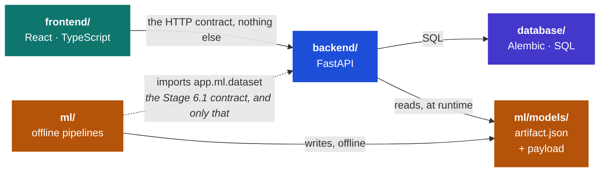
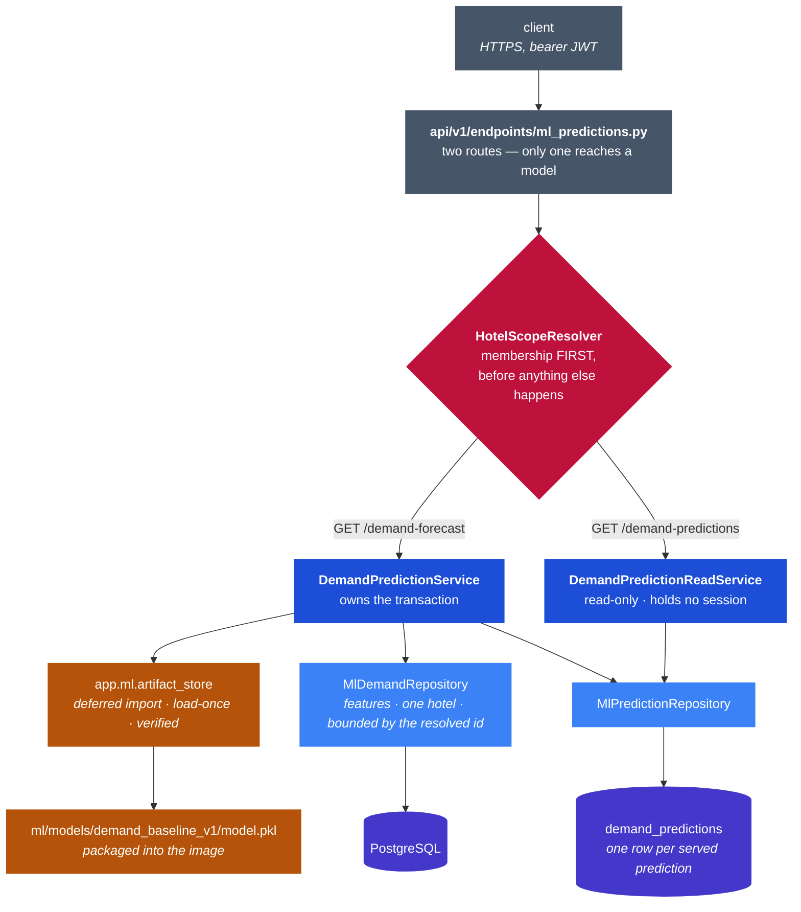

# Architecture

This document describes the architecture of the system as it is, and the rules it is held to.
Where something is planned rather than built, it says so in those words. Where a passage records
the stage that introduced something, or a figure true only at one stage, it names the stage.

It was originally written as a statement of intent before the code existed. It is now a
description of what is there: every rule below is enforced by code and asserted by the test
suite. On 2026-11-25 (roadmap R6.1) it absorbed three stage snapshots that had stopped being
maintained: the backend at Stage 3B.12 (now §2.1–§2.6, §4.1 and §8), the analytics design of
Stage 3B.10 and the statistical intelligence layer of Stage 3B.11 (both now in §5). The schema's
design and implementation records went to [the database README](../database/README.md) the same
day. Their old paths are short redirects. This document, the database README and the runbooks
under [`deployment/`](deployment/) are the ones maintained as current.

---

## 1. Separation of areas

Five areas, deliberately kept apart at the top level of the repository:

| Area | Holds |
|---|---|
| `backend/` | HTTP API and business logic (Python, FastAPI) |
| `frontend/` | Browser client (React, TypeScript, Vite) |
| `database/` | Migrations and raw SQL -- the database as a database |
| `ml/` | Datasets, training pipelines and the trained artifact |
| `docs/` | Documentation |
| `tests/` | Test suite, mirroring the source layout |



The dependency rules between them:

| Area | May depend on | May never depend on |
|---|---|---|
| `backend/` | trained artifacts in `ml/models/` (read-only, at runtime), and two **named** modules of `ml/` through two **named** bridges | `frontend/`, `ml/pipelines/` |
| `frontend/` | the HTTP API contract only | backend source, the database |
| `ml/` | `ml/data/` | `backend/` |
| `database/` | nothing | everything |

The consequence worth stating plainly: **the arrow only ever points one way.** `ml/` imports
nothing from `backend/`, and `backend/` reaches `ml/` from exactly two modules, each with a
function-local import and a single declared target:

| Bridge | Reaches | Added by | Why it is not a dependency |
|---|---|---|---|
| `app/ml/artifact_store.py` | `ml.artifact`, `ml.inference` | Stage 6.6 | Deferred, so `ml` is not needed to start the app; a missing artifact is a 503 |
| `app/ml/accuracy.py` | `ml.metrics` | Stage 6.9 | `ml/metrics.py` imports only the standard library and already ships in the image |

`tests/backend/test_ml_serving.py` pins the allowlist and the target of each bridge, so a third
importer -- a convenience in a service, a shortcut in a router -- fails the suite rather than
quietly widening the boundary. Everything else that crosses is still a file on disk.

---

## 2. Backend layering

```
HTTP request
    |
    v
api/         routing, validation, status codes.       Knows HTTP. Knows no business rules.
    |
    v
services/    business rules, orchestration.           Knows the domain. Knows no HTTP, no SQL.
    |
    v
repositories/ query construction, data access.        Knows SQL. Knows no business rules.
    |
    v
db/ + models/ engine, session, ORM mapping
```

Calls travel downward only. A service never sees a `Request`; a repository never decides
whether an action is permitted; an endpoint never builds a query.

`schemas/` (Pydantic) defines what crosses the HTTP boundary. `models/` (SQLAlchemy) defines
what is stored. They are kept as separate types on purpose -- so that a change to the storage
layout is not automatically a public API change.

`core/` holds cross-cutting concerns: configuration, logging, the error taxonomy, password
hashing and tokens, rate limiting, request-id propagation, security headers and the
trusted-proxy client-address rules. `middleware/` carries the ASGI middlewares that apply the
last two per request, and the request-body size cap.

**Transaction ownership, which is the layering rule with teeth.** A repository never commits.
`grep` for `.commit()` under `backend/app/repositories/` returns nothing, and it is meant to
stay that way: repositories build and run queries, services decide when a unit of work is
finished. The request-scoped session in `db/session.py` commits on success and rolls back on
an exception, so a service that raises cannot leave a half-written change behind.

**Multi-tenant isolation is structural rather than conditional.** Every hotel-scoped service is
reached through `HotelServiceDep -> HotelAccessPolicyDep -> CurrentUserDep`, so there is no path
to a domain service that skips authentication — see `backend/app/api/deps.py`. Where a
cross-tenant lookup would otherwise be expressible, the repository method simply does not exist,
and the database backs this up with composite foreign keys that carry `hotel_id`. Public
identifiers at the API boundary are UUIDs; internal `BIGINT` keys are never serialised.

**At V1:** every layer directory was populated — `api/` 28 files, `services/` 23, `schemas/` 20,
`repositories/` 18, `models/` 14, `core/` 9, `db/` 3, `middleware/` 3, `ml/` 2 — and the HTTP
surface was 82 operations, of which 77 required authentication.

**At Stage 7.14** *(the v2.0 line has added files and operations since; the README's
[project structure](../README.md#project-structure) and overview give the current counts, and
`tests/backend/test_readme_counts.py` computes the operation figures from the OpenAPI document)*:
`api/` 34 files, `services/` 35, `schemas/` 29,
`repositories/` 23, `models/` 18, `core/` 9, `db/` 3, `middleware/` 3, `ml/` 10, and the V2
packages `llm/` 11, `copilot/` 16, `knowledge/` 2 and `jobs/` 2 (tracked `.py` files, each
`__init__.py` included). The HTTP surface is **64 paths / 99 operations**, of which **94 require
authentication**; the 5 that do not are the version-metadata endpoint (`GET /api/v1/`),
registration, login and the two health probes — the same five as at V1.

**What moved it, and when.** Seventeen operations have been added since V1; none was removed.

| Stage | Added | Operations after |
|---|---|---|
| 6.6 | `GET …/ml/demand-forecast` — the demand model's serving boundary | 83 |
| 6.11 | `GET …/ml/demand-predictions` | 84 |
| 7.3 | `GET …/ml/forecast-accuracy`, `GET …/ml/prediction-distribution` | 86 |
| 7.7 | `POST …/copilot/ask` | 87 |
| 7.9 | `GET`/`POST …/documents`, `GET …/documents/{id}`, `POST …/documents/{id}/versions`, `POST …/documents/{id}/withdrawal`, `GET …/knowledge/search` | 93 |
| 7.11 | `GET`/`POST …/copilot/conversations`, `GET`/`DELETE …/copilot/conversations/{id}`, `POST …/copilot/conversations/{id}/messages` | 98 |
| 7.12 | `GET …/intelligence/priorities` | 99 |

All seventeen are hotel-scoped and authenticated. Stages 7.13 and 7.14 and the V2 closure changed
no route: the copilot screen is front-end only, the multi-horizon models are offline, and the
conversation purge is an operator command (`python -m app.jobs.purge_conversations`), not an
endpoint; so is Issue 4's accounting-record purge (`python -m app.jobs.purge_llm_invocations`)
and Issue H8's stored-prediction purge (`python -m app.jobs.purge_demand_predictions`).

Of the four `/ml` routes, **only the serving route loads the model**: it declares a `503` for an
unavailable artifact and the other three declare none, because they load none. The copilot's
`get_demand_forecast` tool delegates to the same `DemandPredictionService`, so a copilot question
can reach the served model too — through the same service, with an unavailable model returned to
the language model as a tool error rather than as a `503`. The three copilot routes that run a
question (`ask`, starting a conversation, adding a message) declare a `503` of their own, for a
language model that is disabled or unreachable. Either way the application reaches the offline
`ml/` package through one module only, behind a lazy import. See [ml-serving.md](ml-serving.md),
[ml-prediction-read-api.md](ml-prediction-read-api.md),
[ml-forecast-performance-api.md](ml-forecast-performance-api.md),
[knowledge-documents.md](knowledge-documents.md), [copilot-conversations.md](copilot-conversations.md)
and [attention-list.md](attention-list.md).

The three reading routes are not symmetric in what they require. `demand-predictions` and
`prediction-distribution` need membership alone; `forecast-accuracy` additionally declares
`require_role(MANAGER)`, because how wrong the model has been is an operational judgement rather
than a figure every member needs. None of the four establishes production accuracy, and each says
so in its own response body rather than only in this document.

Stage 6.7 made the serving route executable in the deployed image: `backend/Dockerfile` became a
three-stage build whose middle stage regenerates the approved model from the committed dataset
and refuses to produce an image unless it matches the Stage 6.5 identity. The image gained one
dependency (`scikit-learn`), thirteen `ml/` modules and the artifact — and no dataset, no
notebook and no training entry point. The HTTP surface did not change.
See [ml-production-runtime.md](ml-production-runtime.md).

Stages 6.8 and 6.11 added two migrations after V1 — `0010_demand_predictions` and
`0011_demand_prediction_public_id` — taking the schema to 22 application tables. Stages 6.9 and
6.10 added services and protocols only: no table, no migration, no route. Stage 7.6 added the
third, `0012_audit_tool_invoked`, which creates nothing: it widens the two closed audit
vocabulary CHECKs by one value each (`tool.invoked`, `tool`) so copilot tool calls are recorded
on the existing append-only trail. Stage 7.7 added the fourth, `0013_llm_invocations`: one
append-only table holding a content-free account of each copilot question (prompt version,
upstream model, stop reason, tokens, latency -- never the question or the answer). Stage 7.9
added the fifth, `0014_hotel_documents`: `hotel_documents` (one immutable row per version) and
`hotel_document_chunks` (append-only, GIN-indexed for full-text search), plus the three
`document.*` audit actions. Stage 7.11 added the sixth, `0015_copilot_conversations`:
`copilot_conversations` and `copilot_messages`, one caller's multi-turn memory at one hotel,
retention-bound and deleted with their turns. Issue 1 added the seventh,
`0016_demand_observation_periods`: one table of declared observation spans -- per hotel, closed
dates, no two sharing a date -- the only evidence the platform accepts that a date's demand is
known. Inside a span a date with no occupied nights is a zero; outside every span it is unknown,
to the demand model, its dataset and the intelligence forecasts alike. Spans are declared by an
operator with `python -m app.jobs.demand_observation` (no route), and go with their hotel (`CASCADE`). Issue 4 added the
eighth, `0017_llm_invocation_retention`, which creates nothing: it replaces the body of `llm_invocations`'
trigger function, so a record is kept 365 days and then deleted by the operator's purge
(`python -m app.jobs.purge_llm_invocations`, no route); UPDATE is still refused. Issue H3 added the
ninth, `0018_composite_set_null_columns`, which recreates the three composite `SET NULL` keys of `revenue` and
`reviews` with column lists, so deleting a booking or a guest keeps those rows and nulls only the
reference. Issue H4 added the tenth, `0019_review_external_id_scope`, which replaces the
reviews' global `(source, external_review_id)` unique index with one per hotel, so another
property's reviews never refuse a recording. Issue H7 added the eleventh,
`0020_guest_email_rules`, which gives a guest's email address the shape `users.email` already
has and makes its per-hotel uniqueness case-insensitive. R1.3a added the twelfth,
`0021_audit_platform_grants`, which widens the audit action CHECK by the platform-administrator
grant and revocation. R3.3 added the thirteenth, `0022_catalogue_versions`, which gives the three
global catalogues an `updated_at` so their PATCHes take `If-Match`. R1.1 added the fourteenth,
`0023_auth_sessions`, the server side of the browser's cookie session. Head `0023` across 23 linear
revisions, 29 application tables. Four of V2's tables reference `hotels` with `RESTRICT`, so — as V1's
append-only audit trail already did — they can make a hotel undeletable: `DELETE /hotels/{id}`
still answers 409 rather than cascading. See [v2-architecture.md](v2-architecture.md) §10. See [knowledge-documents.md](knowledge-documents.md) and
[copilot-conversations.md](copilot-conversations.md).

### 2.1 Domains

Stage 3B built the domain API one domain per stage, over the Stage 2 schema:

| Domain | Stage | Scope | Lifecycle |
|---|---|---|---|
| Hotels | 3B.1 | root tenant | CRUD, delete RESTRICTed by dependents |
| Room types | 3B.2 | per hotel, keyed by `code` | CRUD |
| Rooms | 3B.3 | per hotel, keyed by `room_number` | CRUD |
| Amenities | 3B.4 | **global catalogue** + per-room-type assignment | CRUD + assign/unassign |
| Guests | 3B.5 | per hotel | CRUD |
| Bookings | 3B.6 | per hotel, with allocations and priced nights | CRUD |
| Payments | 3B.7 | per booking | **append-only** |
| Reviews | 3B.8 | per stay (singleton) + hotel-wide listing | create + moderate, no delete |
| Financial ledger | 3B.9 | revenue/expenses per hotel; **global** categories | ledger **append-only**, categories CRUD |
| Analytics | 3B.10 | per hotel | **read-only** — §5 |
| Intelligence | 3B.11 | per hotel | **read-only** — §5 |

At the end of Stage 3B.12 that was 38 paths and 68 operations, with no authentication at all.
V1 then added authentication and membership, platform administration, availability search, the
booking state machine and stay operations, and the audit trail; V2 and the v2.0 line added the
routes in the table above and the cookie session. The routers are the modules under
`backend/app/api/v1/endpoints/`, and the current path and operation counts are in the
[README](../README.md), where a test computes them from the OpenAPI document.

Three collections sit outside the hotel hierarchy — `amenities`, `revenue-categories`,
`expense-categories` — and only because the **schema** models them as global: none of those
three tables has a `hotel_id` column. `tests/backend/test_architecture_audit.py` asserts that
justification against the models rather than taking it on trust, and requires every other domain
collection to be hotel-scoped.

### 2.2 What each layer owns, and how that is enforced

```
router  →  service  →  repository  →  SQLAlchemy  →  PostgreSQL
```

| Layer | Owns | Must not |
|---|---|---|
| Router | HTTP: paths, status codes, query/path binding | build queries, hold a `Session`, commit, raise `HTTPException`, import a model or repository |
| Service | domain rules, **transaction boundaries**, SQLSTATE translation, orchestration | construct SQLAlchemy queries, import FastAPI |
| Repository | queries; `flush` when the database must assign something | `commit`, `rollback`, translate domain errors, know about HTTP |

`tests/backend/test_architecture_audit.py` enforces this **by discovery**: it walks
`app.api.v1.endpoints`, `app.repositories` and `app.services` with `pkgutil` and audits every
module found, so a domain added later is covered the day it appears. The checks are AST-based.
Text scanning produced four false positives early in the project — `RoomRevenueRow` contains
"Revenue", a docstring explaining that `exc_info` is avoided contains "exc_info", a router
description explaining that payments are *not* a revenue proxy contains "Payment" — so
identifiers are matched exactly and docstrings are stripped first.

**One documented exemption:** `health` runs a connectivity probe from its repository and owns
no domain rules. It is excluded at parametrize time, not skipped, so the test count never
hides a gap.

### 2.3 Transaction boundaries and conditional updates

A repository **flushes**; a service **commits**. A service that writes must both `commit()`
and `rollback()`, and a read-only service must do neither. That asymmetry is asserted rather
than assumed: `analytics` and `intelligence` are proven to be in the read-only set, and every
write domain in the other.

The hardest case is booking creation: header, allocations and priced nights are one
transaction, because the night-completeness trigger is `DEFERRABLE INITIALLY DEFERRED` and
judges the whole thing at COMMIT. An allocation is legitimately incomplete part-way through —
that is exactly what deferring buys — which is why it cannot be split across requests.

Rollback is verified end to end for the write domains in
`tests/integration/test_cross_domain.py`: a rejected booking, an overlapping booking, a
duplicate payment reference, a second review of one stay, a refused category delete, a rejected
guest update and a refused booking delete each leave the database unchanged.

**Conditional updates (Issue H6, R3.3).** Without help, a PATCH is last-write-wins: a client
that loaded a record, waited and saved overwrote whatever was written in between. Eight routes
take an optional `If-Match` — the hotel, guest, room type, room and booking PATCHes (Issue H6),
and the amenity, revenue-category and expense-category PATCHes (R3.3) — carrying the record's
own `updated_at` as a strong entity-tag, exactly as the API returned it
(`"2026-10-09T10:00:00.123456Z"`):

- **Lock, then compare, in the update's own transaction.** With the header, the service
  re-reads the row under a row lock (`populate_existing`) before anything else the update does
  — the empty-update shortcut included — and compares `updated_at` by **instant and exact
  equality**. Never by order: the `set_updated_at` trigger stamps `now()`, the transaction's
  *start*, so stamps need not follow commit order. A writer that commits while the update
  waits for the lock is therefore seen, not overwritten.
- **The lock** is the one the row's other writers already contend on: `FOR UPDATE` on a
  booking (`BookingRepository.lock_for_update`, shared with status transitions and stay
  moves); `FOR NO KEY UPDATE` on a hotel, guest, room type, room or catalogue entry — the lock
  PostgreSQL's own non-key UPDATE takes, so it serialises with every writer of the row without
  making the foreign-key checks of unrelated inserts (`FOR KEY SHARE`) wait behind an edit.
- **A mismatch is `412 STALE_UPDATE`**, raised before anything is flushed: nothing is written.
  A malformed header — a weak `W/` tag, an unquoted value, a list, a timestamp without a zone
  or finer than a microsecond — is the usual `422 VALIDATION_ERROR` located at
  `["header", "If-Match"]`. `*` constrains nothing.
- **No header, no change.** The update runs exactly as before: no lock, no comparison. Every
  existing client keeps working; the frontend always sends one from its edit forms.
- **Not on commands.** Booking status changes and stay moves are judged against the current
  state under the booking's lock already; member role changes, review moderation and the room
  status control are single deliberate commands. None of them carries the precondition.
- **The global catalogues since R3.3.** H6 could not cover `amenities`, `revenue_categories`
  and `expense_categories`: they had no `updated_at`, so there was no version to name. Migration
  `0022_catalogue_versions` gave each one — and no `created_at` — maintained by the same
  `set_updated_at` trigger; rows that existed before it received the migration's own time, a
  valid version though not a record of their last write. Their PATCHes take the same
  precondition, and the platform page sends the loaded version and offers the same explicit
  reload on a 412.

The edit forms send only the fields that differ from the record as loaded (each side put
through the same draft-to-payload function), so even without a precondition an update cannot
restore, from a stale form, a value someone else saved to a field this operator never touched.

### 2.4 Tenant isolation, in detail

**The hotel is resolved first, always.** `HotelScopeResolver.require_hotel` turns the URL's
`public_id` into an internal key before any child query runs, and no repository method accepts
a public id — so a query cannot be issued before the tenant is established. Since V1 the
caller's membership is checked on the way in (`HotelAccessPolicyDep`, above), and an unknown
hotel and a non-member get the same 404.

**Scoping is structural, not conditional.** Where a cross-tenant lookup would be possible, the
method simply does not exist. `PaymentRepository` has no `get_by_public_id`; `ReviewRepository`
requires hotel *and* booking. That matters because `public_id` is globally unique: a
booking-only lookup would succeed across tenants for anyone holding another property's id.

**Composite foreign keys carry `hotel_id`** throughout, so the database refuses a cross-tenant
reference even if application code tried. Two places where the key alone is *not* enough, and
the service closes the gap:

- `payments.refunded_payment_id` is a single-column foreign key with no tenant in it. A
  refund's parent is resolved through `get_in_booking`, so a refund can only reverse a payment
  the caller already had access to.
- `revenue.booking_id` is resolved hotel-first, turning what would be a 409 into an honest 404.

Verified end to end in `tests/integration/test_cross_domain.py`: two hotels with the same room
numbers, the same room-type code and the same shape, and every meaningful cross-hotel operation
attempted — guest, booking, payment, refund, review, room and room-type, amenity assignment,
revenue posting, analytics and intelligence. Each returns 404 and changes nothing.

### 2.5 Identifiers and credentials

| Table | URL identity | Why |
|---|---|---|
| hotels, guests, bookings, payments | `public_id` UUID | server-assigned, non-enumerable |
| room_types, amenities, revenue/expense categories | `code` | natural key, `UNIQUE` |
| rooms | `room_number` | `UNIQUE (hotel_id, room_number)` |
| reviews | its **booking's** `public_id` | `uq_reviews_booking_id` makes it a singleton |
| revenue, expenses | **none — not individually addressable** | no `public_id`, no unique key at all |

The tables added after Stage 3B that are addressed by URL (stored demand predictions, knowledge
documents, copilot conversations) carry a `public_id` UUID too. No internal BIGINT appears in
any path or any response: every path parameter must end in `public_id` or be one of four named
natural keys, and every generated OpenAPI component is scanned for
`id`/`hotel_id`/`guest_id`/`booking_id`/`room_id`/`category_id`/`payment_id`.

The last row of the table is the interesting one. `revenue` and `expenses` have no `public_id`
and no unique constraint beyond the primary key — two byte-identical lines coexist — so there is
no key a single-entry URL could use, and the sequential BIGINT is not an acceptable substitute.
Those journals are therefore **append-only with no single-entry route**, which is also what the
schema's own design points at: `amount` carries no positivity CHECK while `tax_amount` does,
making a compensating negative line the correction mechanism.

**Two credentials, one identity (R1.1).** `get_current_user` accepts either an
`Authorization: Bearer` token — `POST /auth/login`, for API clients — or the browser's cookie
session from `POST /auth/session`. The header wins when both are present. **A
cookie-authenticated request that is not a GET must carry the session's CSRF token in
`X-CSRF-Token`, or it is `403 CSRF_FAILED`** before the route runs: a browser attaches a cookie
to any request, a header only to its own. This holds on every unsafe operation, so the OpenAPI
document adds the 403 wherever none is declared (`app.api.openapi`); where a role or platform 403
already is, its description stands and this rule applies beside it. A cookie session's access
token names its session (`sid`), and the request is refused once that session has ended. The
session design is in [§7.1](#71-session-handling-and-its-limitation).

### 2.6 Guarantees the database owns

These correctness guarantees come from PostgreSQL, and the application deliberately does
**not** re-implement them as pre-checks — a check-then-insert would be both redundant and
raceable. Their design is in [the database README](../database/README.md#schema-design).

| Guarantee | Mechanism | Constraint |
|---|---|---|
| No double-booked room | **EXCLUDE USING gist** | `excl_booking_rooms_room_no_overlap`, `WHERE booking_status IN ('confirmed','checked_in')` |
| Every night of a stay is priced | **deferred constraint trigger** | `trg_booking_room_nights_complete` |
| Webhook idempotency | **partial UNIQUE** | `uq_payments_provider_transaction_reference WHERE transaction_reference IS NOT NULL` |
| One review per stay | **partial UNIQUE** | `uq_reviews_booking_id WHERE booking_id IS NOT NULL` |
| One guest email per hotel, whatever its case | **partial UNIQUE** on an expression | `uq_guests_hotel_id_lower_email` — `(hotel_id, lower(email)) WHERE email IS NOT NULL`; a duplicate is a 409 that never quotes the address |
| A guest email has the shape a user's has | **CHECK** | `ck_guests_email_format` — the pattern of `ck_users_email_format`, mirrored as a 422 at the edge |
| One review per platform reference, per hotel | **partial UNIQUE** | `uq_reviews_hotel_source_external_review_id WHERE external_review_id IS NOT NULL` — `(hotel_id, source, external_review_id)`; a duplicate is a 409 `DUPLICATE_EXTERNAL_REVIEW` |
| Unique hotel slug / room number / booking reference / category code | **UNIQUE** | `uq_hotels_slug`, `uq_rooms_hotel_id_room_number`, `uq_bookings_hotel_id_reference`, `uq_*_categories_code` |
| Category in use cannot be deleted | **FK ON DELETE RESTRICT** | `fk_revenue_category_id_*`, `fk_expenses_category_id_*` |
| Cross-tenant reference refused | **composite FK** | `(child_id, hotel_id) → parent(id, hotel_id)` throughout |
| Value vocabularies and ranges | **CHECK** | statuses, currencies, rating scale, recurrence biconditional |
| Derived values cannot contradict inputs | **GENERATED ALWAYS** | `rating_normalized`, `booking_rooms.nights`, the `daily_hotel_metrics` ratios |

Two tests in `tests/integration/test_cross_domain.py` prove the *absence* of a pre-check: a
`pending` booking can reuse a room another pending booking holds (because the exclusion
constraint's `WHERE` excludes pending — an application-level "is this room free" check would
almost certainly have got that wrong), and a two-night night-list for a three-night stay is
refused by the trigger at COMMIT. Optimistic concurrency is §2.3's `If-Match`; creation races
were always decided by the database.

---

## 3. Configuration

Configuration comes from the environment, never from literals in code, so one artifact runs in
every environment. `backend/app/core/config.py` reads it into a validated Pydantic `Settings`
object, and `.env.example` is the checked-in documentation of every variable.

Development and production are separated by the `ENVIRONMENT` variable rather than by separate
code paths. One visible consequence today: interactive API docs are served everywhere except
production.

Most settings have a working default so a fresh checkout runs, but that stops where it should:
`Settings` refuses to construct a **production** configuration without a `SECRET_KEY` and will
not fall back to a built-in one. A misconfigured deployment fails loudly instead of running
insecurely, and because `database/migrations/env.py` constructs the same `Settings`, it fails at
the migration rather than later in the API.

---

## 4. Request lifecycle

1. A request ID is assigned and bound to the logging context (`middleware/request_id.py`).
2. CORS middleware admits or rejects the browser origin.
3. A body larger than `MAX_REQUEST_BODY_BYTES` (default 2 MiB) is refused `413
   REQUEST_TOO_LARGE` before it is buffered: at once when its `Content-Length` says so, or as
   the bytes arrive when it declares none (`middleware/request_size.py`). Every field also has
   a schema bound, but a schema only runs after the whole body has been read.
4. FastAPI validates the request against a Pydantic schema.
5. Dependencies resolve the database session and the authenticated user, and — for every
   hotel-scoped route — the caller's membership of that hotel.
6. The endpoint calls a service.
7. The service applies business rules and calls repositories.
8. The response is serialised through a response schema.
9. Domain errors map to one uniform error envelope (`core/errors.py`). Request-validation
   failures use it too, and `/openapi.json` documents every 422 as that envelope rather
   than FastAPI's default `HTTPValidationError` body, which the server never sends.
10. Security headers are applied on the way out (`middleware/security_headers.py`).

All ten steps exist. Step 9 is worth reading in full before changing anything near it: the
envelope is deliberately uninformative about internals, and 500-class faults carry one fixed
sentence so that a client cannot learn a constraint name, a relation or a SQLSTATE from an
error response. The detail goes to the logs, correlated by the request id from step 1.

### 4.1 Error handling

One envelope, everywhere:

```json
{"error": {"code": "...", "message": "...", "details": []}}
```

Services translate SQLSTATEs using the **single shared vocabulary** in `app/core/errors.py`.
`tests/backend/test_architecture_audit.py` asserts that no service declares its own `"23505"`,
`"23514"`, `"23503"`, `"23001"`, `"23502"` or `"23P01"`, and that the shared vocabulary is the
one used.

Two distinctions that are easy to get wrong and are therefore centralised:

- **`23001` vs `23503`** — an explicit `ON DELETE RESTRICT` raises `restrict_violation`, not
  `foreign_key_violation`. Checking only `23503` falls silently through to a generic message.
- **`23502` is not a dependency signal** in general — on an INSERT it means a required column
  was omitted. `core/errors.py` documents the one narrow case in which the code reads it as one:
  a composite `ON DELETE SET NULL` that could not fire, which is what all three such keys did
  before migration `0018` ([the database README](../database/README.md#4-relationships-and-cardinality)).

**Nothing vendor-specific escapes.** Every conflict the cross-domain suite can produce is
checked against one list of forbidden strings — `psycopg`, `sqlalchemy`, `DETAIL:`, SQL
keywords, `Traceback`, every SQLSTATE, and the `uq_`/`fk_`/`ck_`/`excl_` constraint-name prefixes
(`tests/integration/test_cross_domain.py`); at Stage 3B.12 there were nine such 409s, across
hotels, rooms, amenities, categories, payments, reviews, bookings and guests.

**No service logs a driver exception** (`test_no_service_logs_a_driver_exception`). `exc_info`
on an `IntegrityError` writes the driver's rendering of the offending row into the log — guest
names, review text, amounts, card fragments, invoice references. Four early services (amenity,
hotel, room, room type) still did this until Stage 3B.12 fixed them; the health probe keeps its
`exc_info` because a connectivity failure carries no row data and its traceback is what an
operator needs.

---

## 5. Data and intelligence architecture

The platform is an operational system *and* an analytics layer reading the same data.

Three layers read that data, and each is kept apart from the others: **analytics**, which
defines the figures; the **statistical intelligence layer**, which forecasts and flags from
analytics' own series; and the **trained demand model** of §5.1–§5.2, fitted offline and served.
A fourth consumer, V2's copilot, reads all three through read-only tools and is specified in
[v2-architecture.md](v2-architecture.md).

**Language models.** Neither analytics nor the statistical layer calls a language model: the
statistical layer is a deterministic standard-library baseline that uses no LLM — and the
trained demand model uses none either. The repository's one language-model boundary is V2's
copilot (`app/llm/`, `app/copilot/`, `app/knowledge/`, Stages 7.5–7.11): off by default, with
local Ollama or Anthropic as providers, read-only tools, and lexical document retrieval through
PostgreSQL full-text search. There is no embedding, no vector database and no agent framework
anywhere in the repository. *(At V1 there was no language-model code at all; Stage 7.5 added the
boundary with nothing using it, and Stage 7.7 the first route that reaches it.)*

### Analytics (Stage 3B.10)

Read-only, hotel-scoped, deterministic. Every metric names its source table and its date column,
so a number in a chart can always be traced back to the rows that produced it. Nothing in
analytics predicts, scores, ranks or recommends: it is the deterministic foundation the
statistical layer and the demand model are measured against. Since V1 its routes require
authentication and hotel membership, like every other hotel-scoped route.

**`daily_hotel_metrics` is not used.** Stage 3B.10 found it an empty snapshot table awaiting a
population job, verified live against PostgreSQL 18.6: zero rows, no function or procedure
referencing it, no trigger writing it (only `trg_daily_hotel_metrics_set_updated_at`), no
materialized view behind it. That is still so (Issue H9): it is reserved for a future job that
is neither implemented nor approved, and the decisions such a job needs first are in
[the database README](../database/README.md#unresolved-before-any-population-job-issue-h9).
So analytics does **not** read it (every hotel would report zeros), does **not** write it
(populating a table from a `GET` would make analytics mutate the business it observes, and a
request-driven write would produce a partial, non-reproducible series — the property the table
exists to avoid), and does **not** invent a job to fill it. It is authoritative in one way:
**its generated columns are the formula definitions**, transcribed rather than re-derived:

```
occupancy_rate = occupied_rooms  / NULLIF(available_rooms, 0)
adr            = room_revenue    / NULLIF(occupied_rooms, 0)
revpar         = room_revenue    / NULLIF(available_rooms, 0)
total_revenue  = room_revenue + other_revenue
```

The `NULLIF` guards are reproduced exactly: an undefined rate is reported as **null**, never
as zero. Zero would drag every downstream average down and poison model training.

**Metric definitions** — the source and date column of every figure:

| Metric | Source | Date column | Notes |
|---|---|---|---|
| `bookings_created.*` | `bookings` | `booked_at`, as a hotel-local date | Same column `daily_hotel_metrics.bookings_created` counts; see below |
| `bookings_by_stay.*` | `bookings` | stay overlap | `check_in_date <= date_to AND check_out_date > date_from`; every status, broken down by status |
| `stay_flow.arrivals` | `bookings` | `check_in_date` | Only `OCCUPANCY_STATUSES` (confirmed, checked in, checked out): cancelled, no-show and pending bookings never arrived |
| `stay_flow.departures` | `bookings` | `check_out_date` | A departure day is **not** a room night; same status rule as arrivals |
| `stay_flow.cancellations` | `bookings` | `cancelled_at`, as a hotel-local date | When the cancellation happened; see below |
| `occupied_room_nights` | `booking_room_nights` | `stay_date` | Joined to `booking_rooms` for status |
| `room_nights_sold` | `booking_room_nights` | `stay_date` | Excludes `is_complimentary` |
| `room_revenue` | `booking_room_nights.rate` | `stay_date` | Currency from the owning booking |
| `other_revenue` | `revenue` | `revenue_date` | Categories where `is_room_revenue = false` |
| `ledger_room_revenue` | `revenue` | `revenue_date` | Categories where `is_room_revenue = true` |
| `total_expenses` | `expenses` | `expense_date` | |
| `reviews.*` | `reviews` | `review_date` | |

**Booking and cancellation days are the hotel's calendar days (Issue F1).** `booked_at` and
`cancelled_at` are instants (`TIMESTAMPTZ`); every other date column above is already a `DATE`
in the hotel's terms. An instant `T` belongs to the hotel-local date
`(T AT TIME ZONE zone)::date`, where `zone` is the hotel's `hotels.timezone` — the
authoritative source — when PostgreSQL recognises it as a named zone (`pg_timezone_names`),
and `UTC` otherwise; a fixed offset such as `+02` is not a named zone. A range of hotel-local
dates `[date_from, date_to]` is the instants from local midnight of `date_from` (inclusive) to
local midnight of `date_to + 1` (exclusive); PostgreSQL's IANA rules make a daylight-saving day
23 or 25 hours long. The database session's `TimeZone` changes nothing. Since R1.5 the API
refuses a zone the IANA database does not define when a hotel is created or updated; the column
itself still accepts any text, so a row written earlier is still read as UTC.

**Both range bounds are inclusive.** A `stay_date` equal to `date_to` counts as a night; a
booking whose `check_out_date` equals `date_to` contributes a departure and no night, because
`ck_booking_room_nights_stay_date_within_stay` requires `stay_date < check_out_date`. The
maximum range is **366 days** (`MAX_RANGE_DAYS`); a longer request is `422`, which bounds the
daily series.

**Why two booking counts.** "How many bookings were made in September" and "how many bookings
stay in September" are different questions with different answers, and a hotel dashboard asks
both. Reporting only creation-dated counts makes the headline figure **zero** for any
forward-looking window — a quietly misleading metric. Both are therefore given, named for their
date semantics. The stay-overlap predicate treats a stay as half-open `[check_in, check_out)`,
matching the `daterange(check_in_date, check_out_date, '[)')` the schema's own exclusion
constraint uses.

**Status is current, not historical.** The schema keeps no status history, so a booking created
in January and cancelled in March counts as cancelled wherever it appears. This is also why the
*daily* series carries no status breakdown: attributing today's status to a past day would
misreport every past day.

**Occupancy** is counted from `booking_room_nights` — one row per room per night, kept gap-free
by the deferred completeness trigger — never from booking headers. **A booking is not
occupancy; a night is.** The status filter is
`OCCUPANCY_STATUSES = (confirmed, checked_in, checked_out)`, deliberately **wider** than
`INVENTORY_HOLDING_STATUSES = (confirmed, checked_in)`: a completed stay no longer blocks a room
but certainly occupied it. `pending`, `cancelled` and `no_show` are excluded, so an abandoned
checkout never appears as occupancy.

```
available_room_nights = COUNT(rooms WHERE is_active) × days_in_range
occupancy_rate        = occupied_room_nights / NULLIF(available_room_nights, 0)
room_revenue          = SUM(booking_room_nights.rate)      -- per booking currency
adr                   = room_revenue / NULLIF(room_nights_sold, 0)
revpar                = room_revenue / NULLIF(available_room_nights, 0)
```

The ADR and RevPAR numerator is the **night rate**, the only per-night truth in the schema.
Deliberately *not* used, and asserted so in tests: `bookings.total_amount` (a header figure
supplied by a client, unrelated to the nights), `room_types.base_price` (a list price, not what
was sold) and `payments` (money moving, not revenue earned). Complimentary nights count as
**occupied** (the room was full) but not as **sold** (they earned nothing), so a comp does not
drag ADR down; `complimentary_room_nights` is reported rather than silently dropped.

**Currency.** `revenue.currency` and `expenses.currency` are per line, and room revenue
inherits the currency of its booking (`booking_room_nights` carries none — approved decision
18), so one hotel can hold EUR, USD, JPY and GBP rows in one range. **Every monetary figure in
every response is a list of per-currency buckets, never a scalar.** There is no FX rate anywhere
in the codebase (approved decision 14; R3.4 is an open decision), the hotel's own currency is
never assumed, and `is_multi_currency` flags the case so a consumer must decide rather than be
handed a misleading headline number. `net_operating_result` is computed **within** each
currency: a currency present on one side only still appears, with the missing side counted as
zero *for that currency* — a fact about entry counts, not an FX assumption. A GBP-only expense
surfaces as a negative GBP result, not folded into EUR.

**The `is_room_revenue` split.** Approved decision 21 makes `booking_room_nights` the single
source of truth for room revenue. The ledger nonetheless *permits* rows against an
`is_room_revenue` category (a Stage 3B.9 finding: the flag is an exclusion signal, not a
constraint). Analytics therefore reports such rows in their **own bucket**,
`ledger_room_revenue`, and adds them to nothing: folding them into `room_revenue` would
double-count against the night rows, and folding them into `other_revenue` would defeat the
flag's purpose. They are excluded from `net_operating_result` for the same reason, and visible
so nothing is silently dropped.

**Join multiplication.** A booking fans out to allocations, allocations to nights, and
independently to revenue lines and reviews; aggregating any two grains in one statement
multiplies both. **Every repository method aggregates exactly one grain**, and the service
composes the results. `tests/integration/test_analytics_api.py` builds the fixture that would
expose the bug — 1 booking, 2 rooms, 4 nights each, 3 revenue lines, 2 expenses, 1 review — and
asserts each KPI independently against a hand-computed number:

| Metric | Correct | A wrong join would give |
|---|---|---|
| room nights | 8 | — |
| room revenue | 800.00 | 2400.00 |
| ledger revenue | 60.00 | 480.00 |
| expenses | 40.00 | 320.00 |
| reviews | 1 | 8 |

`tests/backend/test_analytics_layering.py` enforces the same rule structurally, by walking every
repository method's AST and asserting it references at most one fan-out model.

**Routes.** All under `/api/v1/hotels/{hotel_public_id}/analytics/`, GET only. `date_from` and
`date_to` are required on every route — a default window would make two identical-looking
requests mean different things on different days.

| Route | Returns |
|---|---|
| `/overview` | KPI snapshot: both booking counts, stay flow, occupancy, room + ledger revenue, expenses, net result, reviews |
| `/daily` | Gap-free chronological daily series |
| `/revenue-by-category` | Ledger revenue by category × currency |
| `/expenses-by-category` | Ledger expenses by category × currency |
| `/reviews` | Totals, 5-band rating distribution, source mix |

There is no flat `/api/v1/analytics`, no `/reports`, no `/dashboard` and no portfolio-wide
route; the hotel segment is where tenant isolation is established. Rating buckets are an
**analytics-layer presentation** of the generated `rating_normalized`, not a schema concept:
bucket *n* covers `((n-1)/5, n/5]`, with `0.0` placed in bucket 1. All five are always emitted,
including empty ones, so a chart has a stable x axis.

**Limitations.** Point-in-time room inventory is not derivable: `rooms.status` (available /
occupied / cleaning / maintenance / out_of_order) and `rooms.is_active` are **current** columns
with no history, so capacity for a past range uses the hotel's inventory *as it stands now*. The
response says so in the payload — `available_room_nights_basis: "current_active_rooms"` —
rather than only in this document. `rooms.status` is deliberately excluded from the denominator:
applying today's housekeeping state to a past date would be wrong. `daily_hotel_metrics` takes
the same view — its `occupancy_rate` divides by `available_rooms` and tracks
`out_of_order_rooms` as a separate figure. Room-status history is roadmap R3.1, an open decision
(decision 6). Room-type performance was considered at Stage 3B.10 and not built: it is cleanly
derivable (`nights → booking_rooms → rooms → room_types`, all many-to-one) but adds a fourth
join level with no consumer.

### The statistical intelligence layer (Stage 3B.11)

A **deterministic statistical layer**, computed on request from analytics' own series. It is
not trained, not learned and not generative. Read-only, hotel-scoped, nothing persisted:

| Capability | Method |
|---|---|
| Occupancy and revenue forecasting | seasonal-naive day-of-week median, falling back to the window median when a weekday bucket is too thin |
| Prediction intervals | median absolute deviation, scaled by 1.4826 |
| Anomaly detection | modified z-score on the MAD, Iglewicz & Hoaglin threshold 3.5 |
| Demand trend | split-window median comparison against an explicit relative threshold |
| Insights | deterministic templates over the figures above |

It lives in `backend/app/ml/timeseries.py` and `backend/app/services/intelligence.py`, is
implemented in the **Python standard library** (`statistics` and `decimal`) — a test asserts that
`numpy`, `pandas`, `sklearn`, `scipy`, `torch`, `tensorflow` and `prophet` appear nowhere in
`timeseries.py` — and carries `MODEL_VERSION = "1.0.0"`. Every response is a pure function of
the hotel, the requested dates and the model version. Stage 7.12's attention list ranks its
outputs; see [attention-list.md](attention-list.md).

**Why a statistical baseline (Stage 3B.11).** Inspected before choosing a model: there was no
labelled training corpus, only an operational database; `daily_hotel_metrics` held 0 rows; the
derivable series (daily occupancy, room revenue, booking counts) were weeks to months long per
hotel, dominated by day-of-week seasonality plus legitimate zeros. A gradient-boosted or neural
forecaster fitted to a few dozen daily points would overfit, be unable to state why it said
anything, and lose to a seasonal baseline on accuracy. So the stage built a transparent
statistical baseline and documented the decision. Where a window has no usable history, the
response says `insufficient_data` and carries no number: no training data is ever fabricated.
*(The trained demand model of §5.1–§5.2 came later, from a published dataset rather than this
database, and sits beside this layer without changing it.)*

**Two observation axes: stay dates and booking intake.** Two kinds of series feed this layer,
and each answers to its own evidence:

| Axis | Series | A day is in the series when | A day with nothing on it |
|---|---|---|---|
| **Stay date** | occupied room nights, room revenue — the forecasts, their anomaly scans and the occupancy outlook | it lies inside a period declared in `demand_observation_periods` (migration 0016, both ends inclusive) | inside a period: **0**. Outside every period: left out — unknown, never 0 |
| **Booking intake** | bookings created, by `booked_at` on the hotel's own calendar day — the demand trend and its anomaly scan | always: every calendar day of the window | **0**: no booking was taken through the platform that day |

They are kept apart on purpose. A declared period says the hotel's booking record is complete
for those **stay dates**; it says nothing about which bookings were **taken** on a day. So it is
never applied to the intake series — **do not use `demand_observation_periods` as a proxy for
booking-intake observation** — and the intake series is never read as observed stay-date demand.
The trend measures bookings taken through the platform: a hotel that started (or stopped) taking
bookings here inside the window shows that as rising (or falling) intake, which is exactly what
the series measures. Declaring booking-intake observation would need a declaration of its own;
none exists. What the responses report:

* `training_window.observations` — the observed stay dates fed to the forecast. **0** means no
  declared period covers the training window: every point is `insufficient_data` with a null
  value, and the page says that no observation period has been declared — not that the history
  is short, and never a 0 forecast.
* `window.observations` on the trend, anomaly, insight and priority responses — the window's
  **calendar days**, the length of the intake series. It is not a stay-date count: a stay-date
  metric that could not be judged reports its own observed days in `metrics_not_assessed`.
* An empty revenue forecast with `training_window.observations` **0** means room revenue is
  **unknown**; with observed days, it means no currency was traded on any of them.

**Occupancy forecast — seasonal-naive day-of-week median.** For each horizon date *D*, take
every training-window observation falling on the same weekday as *D* and use their median:

```
prediction  = median(same-weekday observations)
half_width  = MAD(same-weekday observations) × 1.4826 × 1.96
interval    = [max(0, prediction − half_width), prediction + half_width]
```

A Saturday resembles other Saturdays far more than the preceding Friday; the median, not the
mean, because one conference or closure would otherwise drag a short window badly. *1.4826*
scales a MAD to a standard-deviation equivalent under normality and *1.96* is the two-sided 95%
quantile: standard constants, not tuned parameters. **Fallback, reported per point:** a weekday
bucket with fewer than `MIN_BUCKET_OBSERVATIONS` (2) entries uses the whole window's median and
reports `method: "overall_median"` instead of `"seasonal_dow_median"` — a single observation
dressed up as a seasonal estimate would be a lie about the evidence.

**Capacity clamp.** A prediction above the hotel's active room count is reduced to it and
flagged `capacity_clamped: true` — the schema's own
`ck_daily_hotel_metrics_occupied_rooms_within_available` asserts occupied ≤ available. The
interval bounds are occupancy figures too and are held to the same capacity, so the published
interval always contains the published prediction and no bound claims a night the hotel cannot
sell; `capacity_clamped` still reports the prediction alone. The occupancy-outlook finding sums
the days as published, so its rate never exceeds 100%. This is the statistical **occupancy**
forecast; the learned **demand** model is the opposite case — its output is unconstrained demand,
never capped, with `exceeds_capacity` reported beside it ([ml-serving.md](ml-serving.md) §9).

**Revenue forecast.** The same model applied to daily room revenue, **independently per
currency**, from `booking_room_nights.rate`. Payments, `room_types.base_price` and ledger revenue
lines are asserted not to reach the calculation. Its days are the training window's observed
stay dates, and its currencies are those earned on at least one of them: a currency seen only
on unobserved days is not forecast, and a currency with no history is **absent**, not forecast
at zero. No cross-currency total appears in any response; a test asserts there is no `total`,
`combined` or `grand_total` field.

**Demand trend — split-window median comparison.** Split the window in half (the odd day goes
to the recent half) and compare medians:

```
relative_change = (recent_median − earlier_median) / |earlier_median|
increasing  if relative_change >  0.10
decreasing  if relative_change < −0.10
stable      otherwise
```

Counted by `bookings.booked_at`, bucketed in the hotel's own time zone as analytics does:
demand is about bookings being **taken**, and stay-dated counts would call a quiet booking month
with a busy stay month "increasing". A least-squares slope was rejected because one outlying day
drags it and it is harder to check by hand; both medians and the threshold are returned, so the
classification is recomputable. A relative change from a zero baseline is undefined, so
`relative_change` is then null and the direction follows the absolute move. What each outcome
guarantees, and nothing more:

| `direction` | Meaning |
|---|---|
| `insufficient_data` | fewer than 7 days in the window; nothing compared |
| `no_activity` | no booking taken on any day |
| `sparse_activity` | bookings were taken, but both halves' medians are zero; no direction |
| `increasing` | earlier median zero and recent median above zero, or a relative rise above the threshold |
| `decreasing` | a relative fall beyond the threshold (a recent median of zero after a non-zero earlier one is a fall of 1) |
| `stable` | a relative change within the threshold, which requires a non-zero median in both halves |

`sparse_activity` exists because the daily values are non-negative counts: a zero median means
more than half the days of that half had no bookings, so the median is blind to every booking
the window holds. Two zero medians used to compare as `stable`, describing a steadiness the
method never observed. The attention list reports only `increasing` and `decreasing`.

**Anomaly detection — modified z-score on the MAD.**

```
score = 0.6745 × (value − median) / MAD        flag when |score| > 3.5
```

Iglewicz & Hoaglin's formulation and cut-off; mean and standard deviation would let the outlier
inflate the very statistic used to judge it. Scanned metrics: `occupied_room_nights`,
`bookings_created`, and `room_revenue[<CCY>]` for each currency earned on an observed stay date.
When the window holds fewer observed stay dates than the scan needs, a currency earned only on
unobserved days is listed in `metrics_not_assessed` as `too_few_observations` with the
observed-day count (**0** when nothing is observed) — its revenue is unknown, which is not the
same as a currency never traded. `metrics_scanned` names every metric looked at, and
`metrics_not_assessed` those that could not be judged, with a reason: `too_few_observations` or
`no_variation`. An empty `anomalies` list means "nothing was unusual" only for the metrics that
were assessed. Every flag carries metric, date, value, window median, MAD, score, threshold and
direction — the whole basis, not a verdict. **MAD = 0 yields no verdict:** at least half the days
share the median exactly (a window of zeros with one busy day has a MAD of zero too), so no day
can be judged unusual *or* usual, and the metric is reported as `no_variation`.

**Insights** are deterministic assembly from the outputs above — `demand_trend`, `anomaly`,
`occupancy_outlook`, `data_sufficiency` — each with `type`, `severity`, `title`, `explanation`,
`supporting_metrics`, `date_from`, `date_to` and, where a model stated one, `confidence`.
Explanations are templates filled from the numbers the insight already carries, so the same data
always produces the same sentence. Ordered by severity, then type, then date.

**Predictions are never mixed with facts.** A hotel already knows part of its future. Every
forecast day carries both, side by side and never blended: `on_the_books_room_nights` /
`on_the_books_room_revenue` (**actual**, counted from the same tables analytics counts) and
`predicted_room_nights` / `predicted_room_revenue` (**predicted**, from history only).

**Temporal leakage is prevented by signature.** `training_window.date_to = horizon.date_from −
1 day`, and every repository call in a forecast path is bounded by that window. The only forward
read is `on_the_books`, reported as a labelled fact and never handed to a model:
`forecast_series` takes horizon **dates**, never horizon values. The live test books a full house
*inside the horizon* and takes the forecast again: the prediction must be byte-identical while the
on-the-books figure moves. A symmetric test inserts data *before* the training window.

**Uncertainty and reproducibility.** Intervals are reported as `interval_lower`,
`interval_upper` and `confidence_level: 0.95`; a zero-width interval is meaningful (a series
that never varied has no spread to project). `predicted_*`, `interval_*` and `confidence_level`
are all nullable, so insufficient data is representable without inventing a value. Every
response carries `model_name`, `model_version`, `methodology`, `generated_at`, the training
window, the horizon, and per-point `method` and `observations`; `generated_at` is the only field
that changes between two identical requests, and the tests compare whole responses with it
removed. No route has a today-relative default: `training_days` and `horizon_days` are fixed
counts relative to the supplied dates, bounded [14, 365] and [1, 90].

**Limitations of this layer.**

- **The baseline is a baseline.** It extrapolates the recent past by weekday. It knows nothing
  about holidays, local events, lead-time booking curves, competitor rates or weather, and it
  will miss a step change until the step is inside the training window.
- **Accuracy degrades with horizon.** A seasonal-naive model repeats the same weekly profile
  indefinitely, so day 90 is no better informed than day 8. The 90-day cap acknowledges this
  rather than fixing it.
- **No backtest or validation metric is computed for this layer.** Rolling-origin backtesting
  exists for the trained demand model (§5.1b), not for these forecasts.
- **Occupancy capacity is current inventory**, as in analytics.
- **Booking-curve / pickup modelling is not implemented.** `bookings.booked_at` and
  `booking_room_nights.stay_date` together would support it.
- **Anomaly scanning is univariate.** A drop in occupancy and a drop in revenue on the same day
  appear as two independent flags.
- **Nothing is persisted.** These forecasts are computed and returned; the stored predictions of
  §5.1c are the demand model's, not this layer's.

Stage 3B.11 left to later stages: booking-curve modelling, rolling-origin backtesting, holiday
and event calendars, multivariate anomaly detection and forecast persistence. The demand model
has since brought backtesting and persistence for itself (§5.1b, §5.1c); for this layer, none of
the five exists. Its tests still assert that the layer's modules hold no pricing, no automatic
rate or allocation change, no background job or queue, and no LLM, embedding, vector store or
external AI call.

### 5.1 The V2 demand dataset (Stage 6.1) — a dataset, not a model

A separate layer, added without touching anything above. It turns the operational tables into a
leakage-safe training dataset: one observation per hotel per calendar date, targeting realised
room-night demand under the same `OCCUPANCY_STATUSES` definition the analytics layer uses.

    MlDemandRepository     SQL, one hotel at a time     app/repositories/ml_demand.py
        |
        v
    MlDatasetService       orchestration, writes nothing  app/services/ml_dataset.py
        |
        v
    app.ml.dataset         pure features, rules, splits   app/ml/dataset.py

Every feature is tied to an explicit prediction cutoff and declared by when it becomes knowable;
splitting is chronological with no shuffle parameter to misuse. **No model is trained and none
exists**, the V1 statistical layer above is unchanged, and there is no public endpoint — the
pipeline is called programmatically. See
[ml-dataset-design.md](ml-dataset-design.md), particularly its limitations.

### 5.1a The offline training dataset (Stage 6.2) — still not a model

The production database holds too little history to train on, which Stage 6.1 measured rather
than assumed. Stage 6.2 acquires real history instead of manufacturing it: a published, CC BY
4.0 hotel-booking dataset (Antonio, de Almeida & Nunes, 2019 — two hotels, 2015–2017), pinned
to a commit, checksum-enforced on every run, and transformed into 1,462 rows over 737 dates.

```
ml/pipelines/offline_demand.py  ---imports--->  app.ml.dataset   (the §5.1 contract)
        |
        v
ml/data/processed/  (ignored)   +   ml/manifests/  (committed: checksums, ranges, partitions)
```

The arrow is the point: the offline pipeline does not define a contract of its own, so a model
trained on its output would consume the same columns, order and cutoff semantics as one served
against the production database. `ml/` is excluded from the backend build context, so nothing
here reaches the API image. **No model is trained, none exists, and no dependency capable of
training one is installed.** See [ml-training-data.md](ml-training-data.md).

### 5.1b The offline backtest (Stage 6.3) — a measurement, not a deployment

The first stage that fits an estimator, and it fits it entirely offline. A seasonal-naive
baseline and one `HistGradientBoostingRegressor` are backtested over 54 chronological origins at
a 7-day horizon; the record lands in `ml/models/demand_baseline_v1/metrics.json`.

```
ml/models.py       feature admissibility, baseline, estimator   (the only sklearn import)
ml/evaluation.py   rolling origins, folds, the chronology assertion
ml/metrics.py      MAE, RMSE, sMAPE, with their denominators
ml/manifests.py    the evaluation record and its content checksum
```

Three properties mattered architecturally at this stage. **The horizon decides the feature set**:
at seven days only 9 of the 15 contract columns are knowable, and the other six are excluded with
recorded reasons rather than by hand — still true. **No artifact is persisted** — nothing was
serialised at Stage 6.3, so nothing could be served; Stage 6.5 fitted one and Stage 6.6 served it.
**`backend/` gained no dependency** — true until Stage 6.7, which added `scikit-learn==1.9.1` to
`backend/requirements.txt` at the same pin `ml/requirements-ml.txt` carries. §5.1c.

The measured numbers, and a section on why they establish neither production accuracy nor
cross-hotel generalisation: [ml-model-evaluation.md](ml-model-evaluation.md).

Stage 6.4 added the validation half: an acceptance policy declared in `ml/policy.py` before any
result was computed and structurally unable to see which method won, a robustness and regime
analysis in `ml/validation.py`, and a registry entry in `ml/registry.py`. The result is PASS on
13 of 13 criteria, all about reproducibility and identity rather than accuracy, which qualifies
`demand_baseline_v1` as the **current offline candidate** and nothing further —
[ml-model-validation.md](ml-model-validation.md), [ml-model-card.md](ml-model-card.md).

Stage 6.5 fitted that candidate once and persisted it: `ml/artifact.py` builds and verifies the
payload, `ml/inference.py` is the offline scoring contract. The payload is **not committed** and
the loader checks its metadata and digest before deserialising it, because a pickle is arbitrary
code on load. *(At Stage 6.5 no route loaded it and nothing under `backend/app` reached either
module. Stage 6.6 drew that arrow deliberately and in one place — §5.1c.)*

### 5.1c Serving, packaging and the record (Stages 6.6-6.11)

The arrow into the backend, drawn once and in one place. Six stages, and none of them changes the
model:



Stage by stage:

- **6.6 — serving.** One authenticated, hotel-scoped `GET .../ml/demand-forecast`. The artifact is
  loaded once per process behind `app/ml/artifact_store.py`, which imports `ml.artifact` *lazily*
  so that a runtime without the offline package answers a served `503` rather than failing to
  start. Authorization is resolved before the artifact is consulted, so a non-member cannot learn
  whether the model is loaded, whether the hotel has history, or whether it exists.
- **6.7 — packaging.** The artifact is regenerated inside a disposable Docker build stage from the
  committed dataset and verified against twenty-two approved values — including the canonical
  model digest — before any image may be built from it. The runtime image carries
  `scikit-learn==1.9.1` (the same pin `ml/requirements-ml.txt` has held since Stage 6.3),
  thirteen `ml/` modules that are
  exactly the import closure of `ml.artifact` and `ml.inference`, and the artifact pair. It carries
  no dataset, no notebook, no manifest, no test directory and no pipeline entry point that fits a
  model.
- **6.8 — persistence.** Every served prediction becomes a row in `demand_predictions`
  (`0010_demand_predictions`), carrying the model identity, the nine inputs, a feature digest and a
  request id. The service owns the transaction: the response and the row commit together or neither
  happens, and a repeat is idempotent through a database-level `ON CONFLICT DO NOTHING`.
- **6.9 — accuracy measurement.** A frozen, content-checksummed protocol
  (`app/ml/accuracy_protocol.py`) comparing stored predictions with realised demand after a 28-day
  settlement lag. Programmatic, computed and returned, never persisted.
- **6.10 — distribution observation.** A second frozen protocol (`app/ml/drift_protocol.py`)
  summarising one window of stored inputs and outputs and comparing it against a baseline window.
  Summaries and differences only.
- **6.11 — the read API.** `GET .../ml/demand-predictions`, paginated, tenant-scoped, addressing
  rows by a `public_id` UUID (`0011_demand_prediction_public_id`) and exposing no internal
  identifier. `DemandPredictionReadService` holds no session and builds no query.

Two architectural rules hold across all six. **Authorization precedes every read**, and an unknown
hotel and a non-member produce byte-identical 404s. And **the artifact never authorises itself**:
`serving_enabled` stays `false` in its metadata, the approval to serve is the reviewed
`APPROVED_MODEL` constant in `backend/app/ml/serving.py`, and the loader refuses an artifact that
claims otherwise.

**What this does not establish:** production accuracy, reliability, generalisation, drift
detection, a threshold, retraining, or superiority over the statistical layer above. None of the
six stages claims any of them; §5.3 keeps them where they belong.

### 5.2 The offline / online boundary

```
operational tables ---> pipelines (offline) ---> artifact + metrics.json
                                                         |
                                                         v
                                          backend loads artifact, serves predictions
```

`ml/` holds the offline half — `data/`, `pipelines/`, `manifests/`, `models/`, `notebooks/`: data
preparation (Stage 6.2), the offline backtest and its `metrics.json` (Stage 6.3), the validation
and registry records (Stage 6.4) and `artifact.json` (Stage 6.5). The fitted payload is generated,
never committed.

**The second arrow is now drawn, and it is the only one.** `app/ml/artifact_store.py` loads a
verified artifact and `ml.inference` scores it; `backend/requirements.txt` pins the same
scikit-learn version as `ml/requirements-ml.txt`, and the API image carries it. What did *not*
cross the boundary is training: no pipeline that fits a model is in the image, nothing on the
serving path calls `fit`, and the artifact the image serves was built and verified before the
image existed. The direction of the diagram is unchanged — data flows offline to artifact to
backend, and never the other way.

### 5.3 FUTURE — NOT IMPLEMENTED

Served demand forecasting has moved out of this table: Stages 6.6-6.7 implemented it, and §5.1c
describes what that does and does not mean. So has an ML surface in the front end: the analytics
screen (Stage 7.2) reads `/ml/demand-forecast`, and the forecasting screen (Stage 7.4) reads
`/ml/demand-predictions`, `/ml/forecast-accuracy` and `/ml/prediction-distribution`. Stage 7.14's
three offline multi-horizon model versions are measured records, not served models. None of the
following exists. They are recorded as
direction, not as capability:

| Module | Input | Output |
|---|---|---|
| Drift detection | stored predictions and features | a statistic, a threshold, an alert. Stage 6.10 observes distributions and decides nothing |
| Retraining and model promotion | a drift or accuracy signal | retraining, and a decision to promote a new version to serving. Stage 7.14 created three more model versions offline ([ml-multi-horizon.md](ml-multi-horizon.md)); none is served, and nothing selects between versions |
| Review sentiment | review text | polarity, aspect breakdown |
| Room image classification | room photographs | room type / feature tags |
| Recommendations | user and hotel history | ranked hotel suggestions |

Rules these must follow when they are built — the first three are already met by the demand model:

- Predictions are persisted with the model version that produced them, so a number can always
  be traced to an artifact. Stage 6.8 is the first stage to do this.
- A missing artifact surfaces as an explicit unavailable-model error. It never degrades into a
  fabricated prediction. Stage 6.6 answers `503`.
- For time-series work, evaluation uses a rolling-origin backtest, not a single split. Stage 6.3
  is the first stage to do this; see [ml-model-evaluation.md](ml-model-evaluation.md).
- An implemented capability is not a validated one, and the documentation says which it has.

---

## 6. Deployment (runtime-verified in CI)

Docker Compose defines four services:

| Service | Image | Role |
|---|---|---|
| `db` | `postgres:18.6-alpine` | The database. Not published to the host. |
| `migrate` | the API image | One-shot `alembic upgrade head`, then exits. |
| `api` | built from `backend/Dockerfile` | uvicorn, running as non-root `appuser`. |
| `frontend` | built from `frontend/Dockerfile` | nginx serving the built SPA and proxying `/api/`. |

Startup is a chain of conditions rather than a sequence of delays:

```
db healthy  →  migrate exits 0  →  api healthy  →  frontend starts
```

`migrate` is a separate service from `api` deliberately. `pg_isready` proves the server accepts
connections, not that a schema exists, and the API's own readiness probe is `SELECT 1`, which
succeeds perfectly well against an empty database -- so without this gate a stack on a fresh
volume would come up with every probe green and every data endpoint failing.
`service_completed_successfully` makes the API's start conditional on the migration having
actually succeeded.

The API image excludes ML dependencies and trained weights. It carries the application package
plus `alembic.ini` and `database/migrations/`, which is why its build context is the repository
root rather than `backend/`: one image both serves requests and applies migrations.

**These files are executed on every push.** A `docker-runtime` job on GitHub Actions builds both
images and runs the stack in a disposable, run-scoped Compose project, asserting the startup
chain, the PostgreSQL version, the schema revision, the SPA fallback, the `/api` proxy, secret
isolation, migration idempotency, persistence across a restart, that the running nginx keeps
serving a REPLACED api container without being restarted itself, and that a failed migration
blocks the API from starting. The repository README lists the gates.

nginx terminates TLS on 443 and is the only published service; port 80 redirects to it, and the
API and database have no host ports. The backend trusts exactly one forwarding peer -- the
frontend container's fixed address -- which is what lets rate limiting, audit attribution and
HSTS see the real client. See [deployment/tls.md](deployment/tls.md).

nginx reaches the API through a variable upstream, against a resolver generated at container
start from the container's own `/etc/resolv.conf`, so a recreated api container is picked up by
the running nginx rather than leaving it bound to the address it resolved once. Nothing in the
compose file is scoped to the Docker daemon rather than to the project, so two stacks coexist on
one host given their own address space. See [deployment/robustness.md](deployment/robustness.md).

Every external base image is pinned by digest rather than by a tag someone else can move, and
the API image runs the same Python the test suite does. CI builds each image twice from scratch
and requires every shipped file to be byte-identical; what that does and does not claim is in
[deployment/reproducibility.md](deployment/reproducibility.md).

Not present, and not claimed here: automated certificate issuance or renewal, and any multi-host
or orchestrated deployment. This is a single-host Compose deployment, and CI proves its TLS with
a self-signed certificate, which is not the same as public-internet readiness.

---

## 7. Frontend / backend separation

The browser client is a separate application that knows the HTTP contract and nothing else. It
holds no database connection, no ORM, no SQL and no shared code with `backend/`; the only thing
crossing between them is JSON over `/api/v1`.

Two consequences are enforced rather than encouraged:

- **One HTTP seam.** `frontend/src/services/api/client.ts` is the only module that calls
  `fetch`, and the only place an `Authorization` header is constructed. A feature module cannot
  reach the network past it.
- **No client-side authority.** Money is never computed in the browser. `frontend/src/lib/decimal.ts`
  works on strings and compares digit by digit; a monetary value becomes a JavaScript number only
  at the display edge, to be handed to `Intl.NumberFormat`. Prices, totals, refunds and
  permissions are all decided server-side, and the browser renders what it is told.

In production both are served from **one origin**: nginx serves the built SPA and proxies
`/api/` to the API, so the bundle is built with an empty API base URL and no CORS is involved.

### 7.1 Session handling, and its limitation

**Since R1.1 the browser signs in to a cookie session**, and no credential is readable by script.
Until then it held a bearer token in `sessionStorage`, which any cross-site-scripting flaw could
have read and taken elsewhere.

- **Three cookies**, all `Secure; SameSite=Strict`: `__Host-ahip_access`, the 30-minute access
  token, `HttpOnly`; `__Secure-ahip_refresh`, a 256-bit refresh secret, `HttpOnly` and sent only
  to `/api/v1/auth/session`; and `__Host-ahip_csrf`, the session's CSRF token, deliberately
  readable. `POST /auth/session` sets them, `POST /auth/session/refresh` renews them and
  `POST /auth/session/end` ends the session and clears them.
- **CSRF.** A request authenticated by the cookie that is not a GET must carry the CSRF token in
  `X-CSRF-Token`, or it is `403 CSRF_FAILED` with nothing done. The token is an HMAC of the
  session id under the signing secret, so the server checks it without a lookup; another site
  can neither read it nor compute it. `SameSite=Strict` already keeps the cookies off other
  sites' requests; the token is the second, independent defence.
- **Server-side state.** `auth_sessions` (migration 0023) keeps each refresh token's SHA-256,
  never the token. A refresh rotates it; a used token presented again is a stolen copy, so the
  whole session ends for both holders. Signing out, a password change (every session of the
  account, in the password's own transaction), deactivation and twelve idle hours
  (`SESSION_REFRESH_TTL_HOURS`) each end a session, and its access tokens stop with it, because
  every cookie-authenticated request checks the access token's session id is still live.
- **The page** (`frontend/src/services/api/client.ts`) sends `credentials: 'include'`, attaches
  the CSRF token to every write, and answers a 401 with one refresh and one retry before it
  treats the session as ended. `sessionStorage` now holds only the CSRF token, as a fallback for
  an environment that cannot hold a `__Host-` cookie.

**What remains.** Script running in the page can still act as the user while it runs — no
session design changes that; the content security policy (`script-src 'self'`, no inline script,
no `eval`) is what narrows it. The bearer login stays for API clients, which keep their own
token and need no CSRF token, because a header is never sent on another site's behalf.

---

## 8. Known limitations, open requirements and deliberate absences

The production-readiness gaps of the whole project, with their decisions, are in
[project-closure-audit.md](project-closure-audit.md) §8. This section keeps the backend's own.

### 8.1 Known limitations of the backend

- **Point-in-time room inventory is not derivable.** `rooms.is_active` and `rooms.status` have
  no history, so a past range's occupancy denominator is current inventory, stated in the
  payload as `available_room_nights_basis: "current_active_rooms"` (§5). R3.1, decision 6.
- **Booking status has no history**, so a status count is always "as it stands now".
- **The statistical forecasts are a seasonal baseline**, with no holidays, events, lead-time
  curves or backtest (§5).
- **A guest email's format check is basic, not RFC 5322.** Since Issue H7 (migration
  `0020_guest_email_rules`) it must match `^[^@\s]+@[^@\s]+\.[^@\s]+$` — the rule `users.email`
  already had — in the schema (a 422) and in the database (`ck_guests_email_format`), and it is
  stored lower case with a case-insensitive per-hotel key. Nothing verifies that the address
  exists. `lower()` in the index follows the database's collation, so for a few non-ASCII
  characters it may fold differently from the API's lower-casing; uniqueness is still enforced,
  by the database's reading.
- **Pagination is OFFSET-based**, with `page_size` capped at 100. Deep pages are
  correspondingly expensive; cursor pagination was explicitly out of scope.

### 8.2 The production requirements Stage 3B.12 listed, and where each stands

Stage 3B.12 ended with seven requirements before the backend could be deployed, in priority
order. The left column is what they were then; the right column is their state now.

| Requirement at Stage 3B.12 | Where it stands |
|---|---|
| **Authentication and authorization — the largest blocker.** None existed: every endpoint was open, and tenant isolation rested entirely on knowing a hotel's `public_id`. The isolation *mechanism* was sound, so authorization was to slot in above it — bind a principal to a set of hotel ids and check it before the hotel is resolved | Done in V1: Argon2id passwords, access tokens, four hotel roles with membership-checked tenant isolation, and platform administration; the browser's cookie session in R1.1 (§7.1). Password reset, email and deactivation are not built — R1.2, an open decision |
| Email format validation on guests | Done by Issue H7, as a deliberate contract tightening: a malformed guest email is a 422 (it was stored as written), every address is stored lower case, and migration `0020_guest_email_rules` adds `ck_guests_email_format` and makes the per-hotel key case-insensitive. Its upgrade refuses, naming hotels and guest ids but never an address, if existing rows would break either rule; it repairs nothing |
| The three composite `SET NULL` corrections | Done by migration `0018_composite_set_null_columns` (Issue H3); see [the database README](../database/README.md#4-relationships-and-cardinality) |
| Optimistic concurrency | Done by an optional `If-Match` on `updated_at`: the hotel, guest, room type, room and booking PATCHes (Issue H6) and the three global catalogues (R3.3) — §2.3 |
| A `daily_hotel_metrics` population job | Reserved, not approved (Issue H9). The table exists and stays empty; analytics computes on demand and the ML dataset pipeline reads its own approved sources, so nothing depends on it. Forecast evaluation relies on the accuracy protocol's settlement lag and on committed, versioned training datasets, not on snapshots. What a job would have to decide first is in [the database README](../database/README.md#unresolved-before-any-population-job-issue-h9) |
| Rate limiting and request size limits — then only `page_size` (100) and the analytics range (366 days) were capped | Login is rate-limited per client address, the copilot and knowledge routes have their own limits and budgets, and every limited route declares 429 (R1.4c); request bodies are capped at 2 MiB (R1.4b, §4). The limits are kept per process, and nothing bounds overall request volume — a shared limiter is R1.4a, an open decision |
| Structured request logging with correlation ids — then a request could not be traced end to end | Done: a request id is assigned and bound to the logging context (§4, step 1) |

### 8.3 What is deliberately absent

At Stage 3B.12 the backend had no frontend, no authentication or authorization, no Docker,
Kubernetes or deployment tooling, no Redis, Celery or Kafka, no background jobs or schedulers, no
external AI APIs, LLMs, embeddings, vector stores or agents, no dynamic pricing and no endpoint
that changes a rate, moves a booking, allocates a room or posts revenue by itself — each asserted
absent by tests. Where each stands now:

| Absent at Stage 3B.12 | Now |
|---|---|
| Frontend | Exists since V1 (§7) |
| Authentication and authorization | Exist since V1 (§8.2) |
| Docker, Kubernetes, deployment tooling | A single-host Docker Compose stack since V1 (§6); no Kubernetes and no orchestration |
| Redis, Celery, Kafka | Still absent: `tests/backend/test_architecture_audit.py` asserts that no router, repository or service imports `celery`, `redis` or `kafka` |
| Background jobs and schedulers | Operator commands under `app/jobs/` run the retention purges, the audit archival and the observation declarations, and an opt-in scheduler service (R4.2) can run the purges and the archival every 24 hours; it is its own service, not part of the API process. The statistical layer still has no job or queue (a test asserts it) |
| External AI APIs and LLMs | V2's copilot (Stage 7.7 on), off by default, reaches a language model only through `app/llm/`; no router, repository or service imports a provider SDK, `openai`, `langchain` or `httpx` (the same audit) |
| Embeddings, vector stores, agents | Still absent. The copilot's tool loop is bounded and read-only, with no agent framework; Stage 7.15, vector retrieval, has not been triggered |
| Dynamic pricing; an endpoint that changes a rate, moves a booking, allocates a room or posts revenue by itself | Still absent: no path contains `pricing`, `recommend`, `optimi`, `auto`, `apply` or `execute` (`test_no_operational_action_endpoint_exists`). Rates, stays and postings change only when a user asks |
